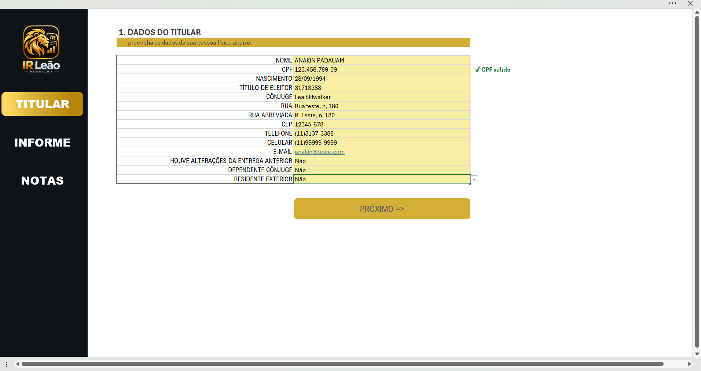
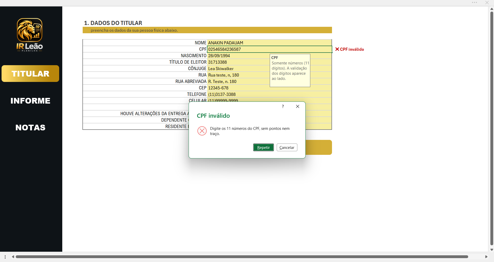
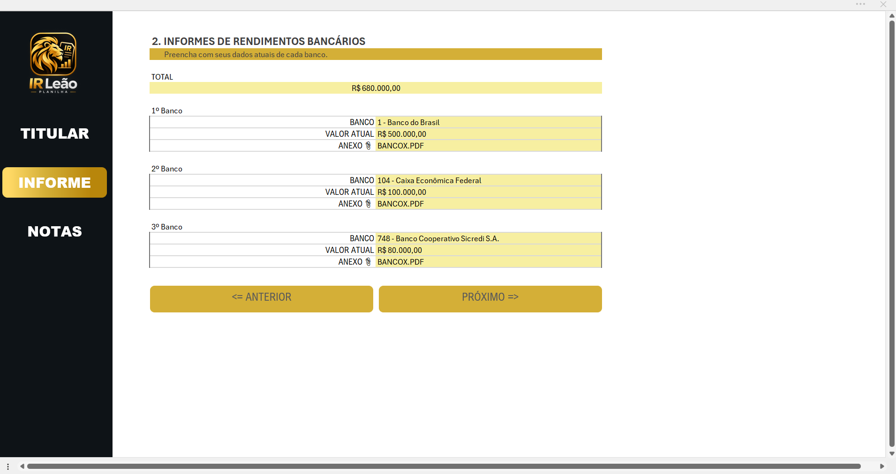
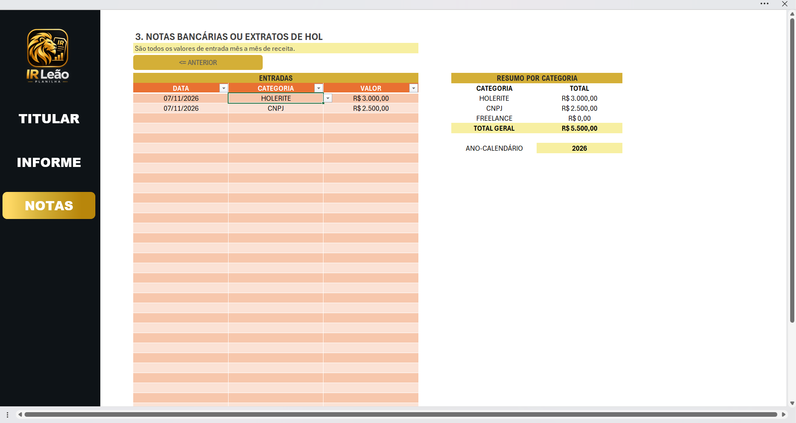
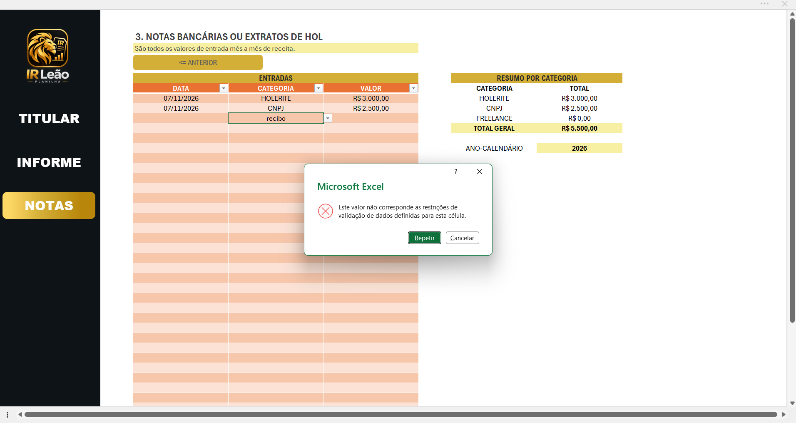

# 🧾 Organizador da Declaração de IR — Excel

Ferramenta em Excel que **reúne e organiza as informações essenciais para a declaração do Imposto de Renda**: dados do titular, saldos bancários e entradas de renda mês a mês. Tudo fica num só arquivo, com menu de navegação, validações automáticas e links rápidos, numa interface que funciona como um aplicativo.

Projeto desenvolvido no **Bootcamp Reclame Aqui** da [DIO](https://www.dio.me/).

> ⚠️ Todos os dados da planilha (nome, CPF, endereço, bancos e valores) são **fictícios** e servem só de exemplo.

---

## 🎯 Problema que a ferramenta resolve

Na época da declaração, as informações costumam estar espalhadas: o CPF num documento, os informes em PDFs de bancos diferentes, os recebimentos em holerites e notas. O organizador centraliza tudo e **impede erros de digitação na hora em que eles acontecem**, como um CPF inválido, uma data fora do ano ou um valor negativo.

---

## 🗂️ Estrutura da planilha

| Aba | Para que serve | O que tem |
|-----|----------------|-----------|
| **Titular** | Dados pessoais do declarante | Nome, CPF com validação, nascimento, título de eleitor, cônjuge, endereço, contatos e perguntas Sim/Não da declaração |
| **Informes** | Informes de rendimentos bancários | Até 3 bancos, cada um com instituição, saldo e nome do anexo, e o **total geral** somado automaticamente |
| **Notas** | Entradas de renda mês a mês | Tabela com data, categoria (holerite, CNPJ, freelance) e valor, mais o **resumo por categoria** e o **ano-calendário** |
| **Tabelas** *(oculta)* | Aba de apoio | Lista de 50 bancos com o código de compensação, usada na validação |

---

## 🧭 Navegação e links rápidos

- **Menu lateral** em todas as abas, com os botões **TITULAR**, **INFORME** e **NOTAS**. São formas com hiperlink interno que levam direto à aba escolhida.
- **Botões de fluxo** *PRÓXIMO =>* e *<= ANTERIOR* para seguir as etapas na ordem: Titular → Informes → Notas.
- **Link de e-mail:** o e-mail do titular é um link `mailto:` que abre uma mensagem já com o assunto *"Precisamos falar sobre sua Declaração de IR"*.
- **Cara de aplicativo:** linhas de grade e títulos de linha/coluna escondidos, cores padronizadas (amarelo para campos de entrada, dourado para títulos) e a aba de apoio oculta.

---

## ✅ Validações automáticas

| Onde | Regra | Como foi feita |
|------|-------|----------------|
| **CPF** (Titular) | Só números inteiros de até 11 dígitos | Validação de dados personalizada |
| **CPF** (Titular) | Os dígitos verificadores precisam estar corretos | Fórmula ao lado do campo que mostra **✔ CPF válido** ou **✖ CPF inválido**, com formatação condicional verde/vermelha |
| **Sim / Não** (Titular) | Respostas padronizadas | Lista suspensa |
| **Banco** (Informes) | Só bancos da lista oficial | Lista suspensa ligada ao intervalo nomeado `lista_bancos`, com mensagem de erro "Banco não encontrado" |
| **Saldos** (Informes) | Valor igual ou maior que zero | Validação decimal |
| **Categoria** (Notas) | Holerite, CNPJ ou Freelance | Lista suspensa |
| **Data** (Notas) | Dentro do ano-calendário informado | Validação de data entre `DATA(ano_calendario;1;1)` e `DATA(ano_calendario;12;31)` |
| **Valor** (Notas) | Maior que zero | Validação decimal |
| **Ano-calendário** (Notas) | Ano entre 2000 e 2100 | Validação de número inteiro |

Cada campo validado mostra uma **dica ao ser selecionado** e uma **mensagem de erro explicando o que corrigir**.

### Como funciona a validação do CPF

O CPF tem 11 dígitos, e os dois últimos (dígitos verificadores) são calculados a partir dos 9 primeiros. A fórmula refaz esse cálculo:

1. Converte o CPF em texto com 11 dígitos usando `TEXTO(D7;"00000000000")`. Assim, os zeros à esquerda não se perdem.
2. **1º dígito:** multiplica os 9 primeiros dígitos pelos pesos de 10 a 2, soma tudo com `SOMARPRODUTO`, multiplica por 10 e tira o resto da divisão por 11. Quando o resultado é 10, o dígito vale 0.
3. **2º dígito:** faz o mesmo com os 10 primeiros dígitos e os pesos de 11 a 2.
4. Compara os dois resultados com o 10º e o 11º dígitos digitados.
5. Rejeita sequências repetidas, como 111.111.111-11, que passariam no cálculo mas não são CPFs válidos.

<details>
<summary>Ver a fórmula completa (como fica gravada no arquivo)</summary>

```excel
=IF(D7="","",IF(AND(
  MOD(MOD(SUMPRODUCT(--MID(TEXT(D7,"00000000000"),{1,2,3,4,5,6,7,8,9},1),{10,9,8,7,6,5,4,3,2})*10,11),10)=--MID(TEXT(D7,"00000000000"),10,1),
  MOD(MOD(SUMPRODUCT(--MID(TEXT(D7,"00000000000"),{1,2,3,4,5,6,7,8,9,10},1),{11,10,9,8,7,6,5,4,3,2})*10,11),10)=--MID(TEXT(D7,"00000000000"),11,1),
  TEXT(D7,"00000000000")<>REPT(LEFT(TEXT(D7,"00000000000"),1),11)),
"✔ CPF válido","✖ CPF inválido"))
```

No Excel em português, as funções aparecem traduzidas: `SE`, `E`, `MOD`, `SOMARPRODUTO`, `EXT.TEXTO`, `TEXTO`, `REPT` e `ESQUERDA`.
</details>

---

## 🧮 Cálculos

| Onde | Fórmula | O que faz |
|------|---------|-----------|
| Informes — Total | `=SOMA(D11;D16;D21)` | Soma os saldos dos três bancos |
| Notas — por categoria | `=SOMASE(Tabela1[CATEGORIA];G9;Tabela1[VALOR])` | Soma as entradas de cada categoria |
| Notas — total geral | `=SOMA(Tabela1[VALOR])` | Soma todas as entradas |

As entradas da aba Notas ficam numa **tabela do Excel** (`Tabela1`). Por isso, as fórmulas usam referências estruturadas, que continuam certas quando novas linhas são preenchidas.

### Intervalos nomeados

| Nome | Endereço | Uso |
|------|----------|-----|
| `lista_bancos` | `Tabelas!$A$2:$A$51` | Origem da lista suspensa de bancos |
| `ano_calendario` | `Notas!$H$14` | Limite das datas aceitas na aba Notas |

---

## 🔒 Proteção

As abas são protegidas. Só os campos de entrada (fundo amarelo) podem ser editados e selecionados, e as fórmulas, títulos e botões ficam bloqueados contra alteração acidental.

---

## 🖼️ Prints

**Titular com CPF válido**



**Mesmo campo com CPF inválido**: a fórmula identifica o erro na hora.



**Informes bancários com o total automático**



**Notas com o resumo por categoria**



**Validação em ação**: uma entrada fora da regra é bloqueada com uma mensagem explicativa.



---

## 🚀 Como usar

1. Baixe o arquivo `Organizador_Declaracao_IR.xlsx` e abra no Excel.
2. Na aba **Titular**, preencha os dados pessoais e confira se o CPF aparece como ✔ válido.
3. Clique em **PRÓXIMO** e, em **Informes**, escolha cada banco na lista e informe o saldo.
4. Siga para **Notas**, ajuste o **ano-calendário** e registre cada entrada de renda com data, categoria e valor.
5. Acompanhe os totais no resumo por categoria.

---

## 📚 O que aprendi

- Montar um **menu de navegação** com formas e hiperlinks internos, dando à planilha cara de aplicativo.
- Usar **validação de dados** de vários tipos (lista, data, decimal, número inteiro e fórmula personalizada), com mensagens de entrada e de erro.
- Criar uma **validação de CPF** com fórmula, combinando `TEXTO`, `EXT.TEXTO`, `SOMARPRODUTO` e `MOD`.
- Trabalhar com **tabelas do Excel**, referências estruturadas e **intervalos nomeados**.
- Proteger a planilha para que só os campos certos fiquem editáveis.
- Documentar o projeto no **GitHub** com README e imagens.

---

## 🛠️ Tecnologias e técnicas

- Microsoft Excel;
- validação de dados e formatação condicional;
- funções `SOMA`, `SOMASE`, `SOMARPRODUTO`, `TEXTO`, `EXT.TEXTO`, `MOD`, `DATA` e `SE`;
- tabelas, intervalos nomeados e proteção de planilha;
- formas com hiperlinks e link `mailto:`.

---

Feito por **Diego dos Santos** no Bootcamp Reclame Aqui da [DIO](https://www.dio.me/).
